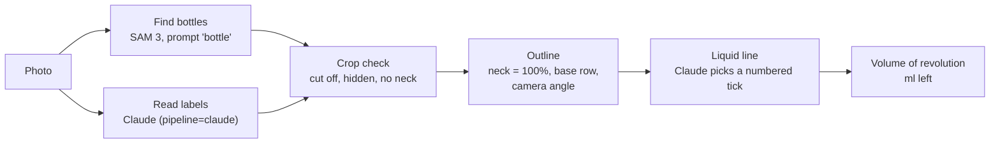

# backbar-vision

Stock tracking for bars from one photo: which bottles are on the shelf, and how much is left in each.

It started as a Saturday hack by Bergen and Allen with a clear target: beat Claude Opus 5.5 by 10 points of item recall, running locally at zero API cost per photo. We did not. This repo holds the pipeline, every prediction file behind the numbers below, and the experiments that explain the gap.

## Results so far

Identification, on our kitchen set (7 photos of the same 12 products, from spirits to milk and ketchup, with the photo as the only input):

| System | Item recall | Brand recall | Runs locally |
|---|---|---|---|
| Claude Opus 5.5, open-ended (`src/identify.py`) | 59.5% | 38.7% | no |
| Qwen3-VL-32B, 4-bit MLX | 38.1% | 15.6% | yes |
| Qwen3.5-9B, 4-bit MLX | 37.7% | 20.3% | yes |
| SigLIP2 retrieval over an external product catalogue, plus OCR | 29.8% | 23.4% | yes |

Our first local pipeline scored 97.6%, but it matched each crop against crops of the same bottles from the other photos, which come from our labels. Ground truth was an input, so the result does not count. The full leaderboard, with that row marked invalid, is in `data/results.csv`.

Fill level, on four photos of one 50 ml miniature holding 7.5 ml, then 15 ml, of water (two photos at each level):

| Method | Mean error (points of bottle size) | Answered |
|---|---|---|
| Outline + Claude points at the liquid line (`geometry:opus-grid`) | 2.1 | 2 of 4 |
| Claude estimates the ml directly (`vlm:opus`) | 19.0 | 4 of 4 |
| Outline + colour edge (`geometry:edge`) | 38.6 | 4 of 4 |
| Outline + LabPics liquid segmentation (`geometry:labpics`) | 73.0 | 4 of 4 |
| Outline + SAM 3 "liquid" (`geometry:sam3`) | 76.8 | 4 of 4 |

That is far too small a sample to publish as a finding. A measured pour series and human labels for the 82-photo bar test set (`data/test_bars/`) come next.

On five bar photos, judged blind: in a human A/B (`data/test_bars/judgements.csv`) Claude's names were right 18 of 23 times and ours 6 of 24. A model judge (Claude Opus 5.5, with web images) gave 65% and 34% on all 365 answers (`data/test_bars/card_verdicts.csv`, `src/score_judged.py`); it is a cross-check, not a result. [`docs/writeup.md`](docs/writeup.md) tells the whole story.

## How it works



- `pipeline=local` finds every bottle with SAM 3 and does not identify it: brand and product stay null and the size is assumed to be a 700 ml spirit bottle. `pipeline=claude` asks Claude for every bottle's brand, product, size and box.
- The crop check (`src/qc.py`) drops bottles that run out of the crop, have no visible neck, or are mostly hidden.
- Fill is volume, not height. The outline's width per row gives a volume of revolution, from the neck (full) down to the base. Only the liquid line comes from Claude: a grid of numbered ticks is drawn on the crop and Claude names the tick at the line. A line with little colour change above and below it is reported as unsure instead of guessed.
- Opaque bottles, upside-down optics and unsure lines come back with `fill_ml: null` and a `fill_note` saying why.

Every bottle comes back as `{position, description, bbox, brand, product, category, liquid, size, unit, glass, fill_ml, id_source, fill_visible, fill_note, label_text}`, with `bbox` as `[x, y, w, h]` in photo pixels and bottles in reading order (shelf rows top to bottom, then left to right).

## Run it

Python 3.12 and [uv](https://docs.astral.sh/uv/):

```
uv venv -p 3.12 .venv && uv pip install -p .venv -r requirements.txt
cp .env.example .env     # add ANTHROPIC_API_KEY
hf auth login            # SAM 3 is gated: accept Meta's licence on huggingface.co/facebook/sam3 first
.venv/bin/uvicorn api:app --app-dir src
```

Open http://localhost:8000 and drop a photo. The first call loads the models, which takes about a minute.

```
curl -F image=@photo.jpg 'localhost:8000/identify?pipeline=local&fill=geometry:opus-grid'
```

Without an API key, use `fill=geometry:edge` (local, much less accurate) or `fill=none`. Interactive API docs are at http://localhost:8000/docs. The Testing and Judge tabs show the leaderboard and blind A/B judging of two prediction files; the Data tab shows the training data once `src/experiments/train_index.py` has built its index.

## Reproduce the numbers

```
.venv/bin/python src/score.py data/predictions.csv                       # Claude baseline
.venv/bin/python src/score.py data/predictions_fill_pour_oracle_geometry_opus-grid.csv --alcohol
.venv/bin/python src/experiment.py data/predictions_pour_oracle.csv geometry:edge vlm:opus
```

`score.py` runs no model; it only reads files. `experiment.py` reruns fill estimators; the ones that ask Claude cost API credits, and answers are cached in `runs/vlm_cache/` so a second run is free.

Tests run offline in a couple of seconds:

```
uv pip install -p .venv -r requirements-dev.txt && .venv/bin/python -m pytest
```

## Layout

- `src/api.py` the HTTP API and web UI; `src/find.py` SAM 3 bottle finder; `src/identify.py` the Claude baseline; `src/fill.py` fill estimators; `src/qc.py` crop check; `src/vlm.py` one cached `ask()` for Claude
- `src/score.py` the scorer; `src/experiment.py` runs fill estimators on any predictions file
- `src/photos.py`, `boxes.py`, `models.py`, `schema.py` helpers shared by the rest
- `src/experiments/` the local identification experiments behind the leaderboard: catalogue collection (`src/experiments/collect_*.py`, `src/experiments/external/`, see `data/external/README.md`; collectors need `CONTACT_EMAIL` in `.env`), test-set hold-out (`src/experiments/holdout.py`, `drop_test_overlap.py`), embedding and training (`src/experiments/backbones.py`, `train_index.py`, `train_head.py`), local pipelines (`catalogue_match.py`, `identify_trained.py`, `fuse.py`, `identify_clip.py`, `identify_vlm.py`)
- the web tabs: `src/testing_routes.py`, `data_routes.py`, `judge_routes.py`, sharing `src/datafiles.py`; pages in `web/`
- `data/labelled/` ground truth; the kitchen photos (`data/raw/`) and pour photos (`data/pour/`), which are not published; `data/test_bars/` the bar test set; `data/predictions_*.csv` every run; `data/results.csv` the leaderboard
- `docs/` research notes on datasets and open-set methods

## Rules we held ourselves to

- Ground truth is the answer, never an input: labels are read by the scorer and nothing else.
- Test photos are never training data. Training images within perceptual-hash distance 6 of a bar test photo are dropped.
- Bar test labels are made by people, never by a model, since the baseline is a model. Fill labels are measured by pouring or weighing.
- A result that broke a rule stays in the leaderboard, marked invalid.

## Licence and credits

Code under Apache-2.0 (`LICENSE`). Our labels and predictions under CC BY 4.0 (`DATA_LICENSE.md`). The kitchen and pour photos, and the bar photos without a known licence, are not published. The bar test photos that are here keep their own licences, listed in `data/test_bars/ATTRIBUTION.md`, and `scripts/download_bars.py` fetches the others for local use.

Models: [SAM 3](https://huggingface.co/facebook/sam3) and SAM 2.1 (Meta), [OWLv2](https://huggingface.co/google/owlv2-base-patch16-ensemble), DINOv2 and SigLIP2, and Sagi Eppel's [LabPics vessel model](https://github.com/sagieppel/Segment_Anything2_Trained_for_Semantic_Seg_Vessell_Fill_level). None are shipped here; each downloads under its own licence.
