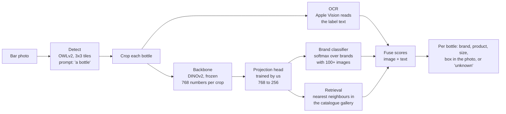
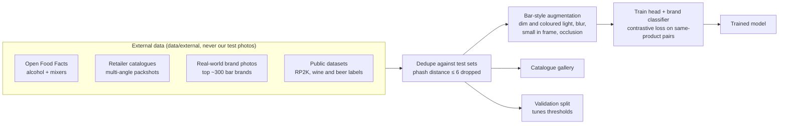
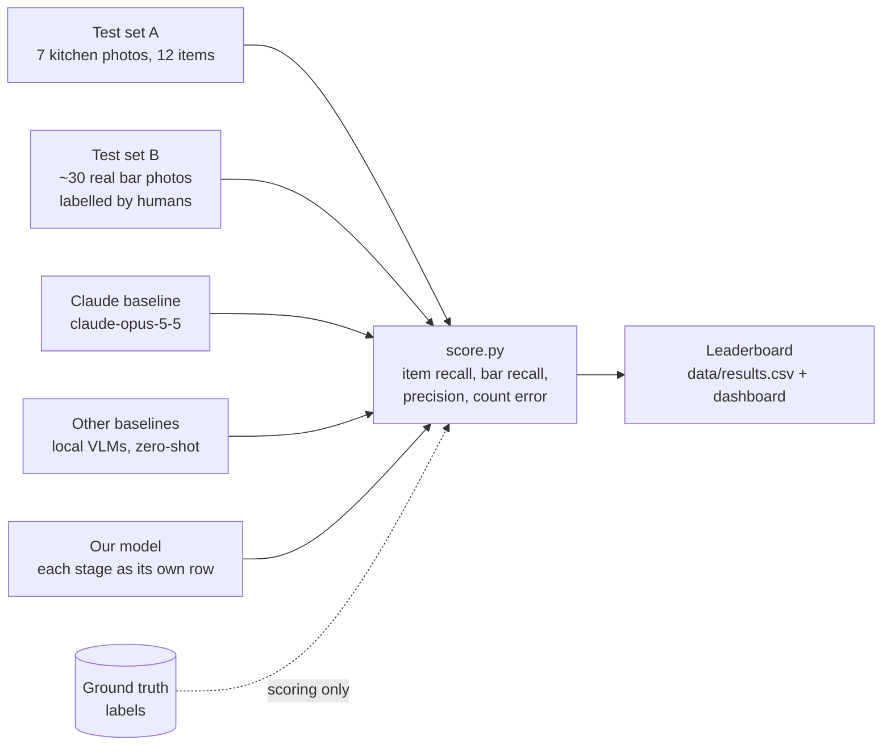

# bottle-vision

Camera-based stock tracking for restaurant bars. From a photo: what bottle, what size, what liquid, how much is left.

## Tasks
1. Identify bottle type, size and liquid.
2. Estimate fill level (% and ml).

**Objective:** beat the Claude baseline by 10+ points of item recall on the human-labelled bar test set, at zero API cost per photo. Photos are the only input; ground truth is only ever used to score.

## The system

### 1. Inference: photo in, stock list out

- **Detect** finds every bottle-shaped object. Tiling keeps small bottles big enough to see.
- **Backbone** turns each crop into a fingerprint. Same product, similar fingerprint, measured by cosine similarity (the angle between them).
- **Projection head** is the part we train: it reshapes the fingerprint space so photos of the same bottle sit close together under bar lighting.
- **Brand classifier** answers "which brand" for brands with enough training photos. **Retrieval** answers "which exact product" by finding the closest catalogue images, and handles new products by just adding their photos.
- **OCR** reads any legible label text and matches it to catalogue names. Logos and blurry labels fall back to the image side.

### 2. Training: external data only


### 3. Evaluation: ground truth only scores

Leaderboard rows for our model, so each stage's contribution is measured: zero-shot retrieval, then + trained head, then + brand classifier, then + OCR fusion.

**Rules:** test photos are never training data; thresholds are tuned on the external validation split, never a test set; a result that used ground truth as input is logged as invalid.

## Data
- `data/raw/` original photos, untouched
- `data/labelled/inventory.csv` ground truth: the 12 items in the set


## Setup
Keys go in `.env`, never committed.

## Run the baseline
```
python3 -m venv .venv && .venv/bin/pip install -r requirements.txt
cp .env.example .env   # add your key
.venv/bin/python src/identify.py data/raw
```
Writes `data/predictions.csv`: one row per bottle (run, photo, position left to right, description, bbox, brand, product, category, liquid, size, unit, glass, fill_ml, id_source, fill_visible).

## Run the API
```
uv pip install -p .venv -r requirements.txt
.venv/bin/uvicorn api:app --app-dir src     # from the repo root
curl -F image=@photo.jpg 'localhost:8000/identify?pipeline=local'
```
Open http://localhost:8000 for the web UI: drop, paste or browse a photo, every bottle comes back boxed and listed, and the Local/Claude toggle compares the two pipelines on the same photo. `POST /identify` takes one photo and returns `{image, pipeline, bottles: [...]}` in the shared output schema. `pipeline=local` (default) runs the local pipeline with k=3 reference crops per item from every photo in `data/crops`, so photos from `data/raw` score themselves; test with new photos. The first local call loads the models (about a minute), later calls take a few seconds. `pipeline=claude` runs the baseline and needs the key in `.env`. Interactive docs at `localhost:8000/docs`.

## Dashboard
`.venv/bin/python src/dashboard.py` then open http://localhost:8501 (read-only view of photos, boxes, predictions, scores and pipeline status).
